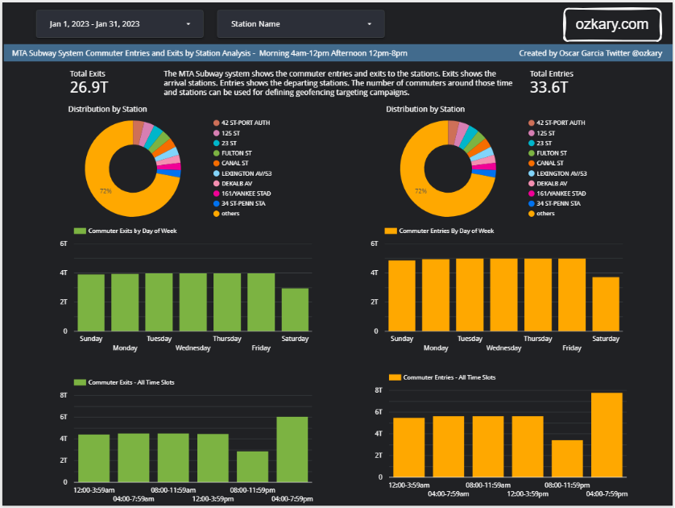
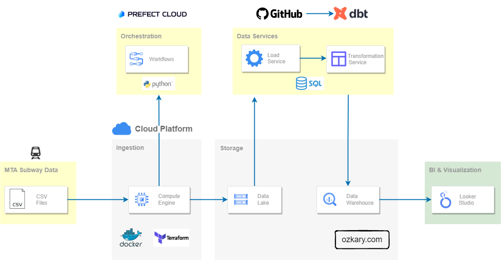
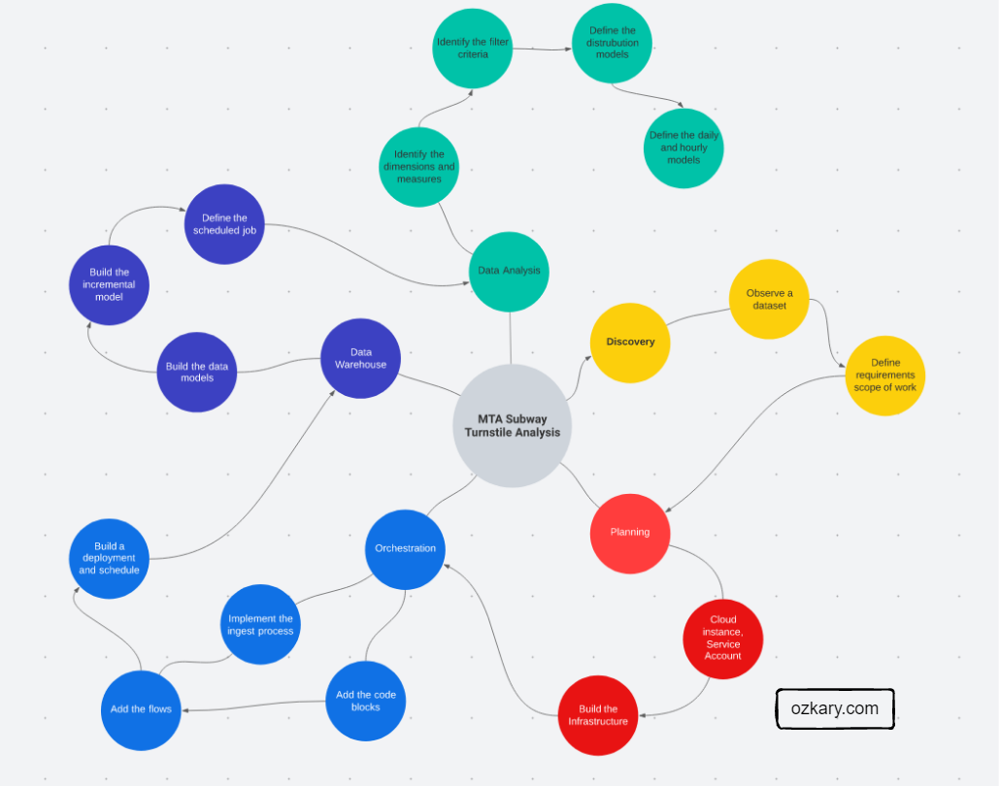

# Introduction to Data Engineering Process Fundamentals

[](LICENSE)
[](https://www.python.org/downloads/release/python-3120/)
[](https://hub.xerj.org/contributors/ozkary)
[](https://github.com/ozkary/data-engineering-mta-turnstile)

Welcome to the **Data Engineering MTA Turnstile** project! This repository leverages real-world NYC MTA Turnstile data to provide a comprehensive, hands-on reference for building modern, **cloud-native** data pipelines using a **process-oriented data engineering** approach.

## What's Inside?

* **Extensive Book — *Data Engineering Process Fundamentals*:** Dive deep into the core concepts, architecture, and lifecycle governance of data engineering.
* **YouTube Video Tutorials:** Follow along with step-by-step video walkthroughs explaining each architectural component in detail.
* **Comprehensive Production-Style Codebase:**
  * **Process-Oriented Architecture:** Enforces clear lifecycle stages (*Ingestion → Raw Data Lake → Warehouse Modeling → Quality & Governance → Analytics*) with idempotency and separation of concerns.
  * **Terraform (Infrastructure as Code):** Provisions and manages reproducible cloud infrastructure (storage buckets, BigQuery datasets, IAM, and compute resources) declaratively.
  * **Docker (Containerization):** Packages ingestion workers, dbt transformations, and Prefect flows into portable, deterministic runtime environments.
  * **Cloud Data Lake:** Scalable object storage for raw and staged turnstile datasets with historical lineage.
  * **BigQuery (Data Warehouse):** Structured dimensional modeling and high-throughput analytical SQL queries.
  * **dbt (Data Build Tool):** Modular SQL transformations, schema contracts, and automated data quality tests.
  * **Prefect (Workflow Orchestration):** Python-based pipeline scheduling, dependency management, retries, and observability.
  * **Python & Jupyter Notebooks:** Core ingestion scripts, schema validation, and interactive exploratory data analysis.
  * **Looker Studio:** Interactive BI dashboards and reporting on ridership trends.
  * **Apache Kafka & Apache Spark:** Distributed message streaming and PySpark window aggregations for real-time processing.
  * **AI Agents & Predictive Modeling:** Agentic data engineering with Model Context Protocol (MCP) and Google ADK alongside ML foot-traffic forecasting.

## Why Use This Repository?

* **Real-World Application:** Built on actual NYC MTA Turnstile ridership data rather than synthetic toy datasets.
* **Process-Oriented Approach:** Treats data pipelines as governed, modular, and testable software systems for clarity, maintainability, and reproducibility.
* **Step-by-Step Implementation:** Designed as a hands-on companion to the book and video series so you can build each layer incrementally.
* **Cloud-Native & Accessible:** Built on real cloud-native infrastructure (Terraform, Docker, BigQuery, Cloud Storage) using free-tier resources and open-source tooling so anyone can recreate and extend the architecture.

---

### Author & Resources
* **Written by:** [Óscar D. García](https://www.ozkary.com)
* **Social:** [Twitter / X (@ozkary)](https://twitter.com/ozkary) • [YouTube (@ozkary)](https://www.youtube.com/@ozkary)
* **Setup & Configuration:** [Project Wiki — Installation & Configuration Guide](https://github.com/ozkary/data-engineering-mta-turnstile/wiki)
  
### Announcement and Updates

> 🏆 **Featured in XERJ Corpus Hub:** Selected as an open reference corpus for AI coding agents ([`ozkary--data-engineering-mta-turnstile`](https://hub.xerj.org/corpus/ozkary--data-engineering-mta-turnstile)) — featuring process-oriented data engineering with Terraform, Docker, BigQuery, dbt, Prefect, Spark, Kafka, and Cloud Data Lakes ([Contributor Profile](https://hub.xerj.org/contributors/ozkary)).  
> 👉 Join our newsletter and get updates on new content about Data Engineering — [Sign up here](https://ozkary.com/newsletter)  
> 👉 Follow us on [Twitter / X (@ozkary)](https://twitter.com/ozkary "Follow Óscar D. García, ozkary on Twitter")  
> 👉 [Data Engineering Process Fundamentals Blog Series](https://www.ozkary.com/2023/03/data-engineering-process-fundamentals.html "Data Engineering Process Fundamentals Series by Óscar D. García, ozkary")  
> 👉 [Data Engineering Process Fundamentals YouTube Video Podcast](https://www.youtube.com/live/14eRohtAE-w?si=8xLECzhfOhBgBB9K "Data Engineering Process Fundamentals YouTube Video by Óscar D. García, ozkary")  
> 👉 [Data Engineering Process Fundamentals Book on Amazon](https://www.amazon.com/Data-Engineering-Process-Fundamentals-Hands/dp/B0CV7TPSNB "Data Engineering Process Fundamentals Book on Amazon by Óscar D. García, ozkary")  

## 📖 Companion Book & Media

<table>
  <tr>
    <td width="160" valign="top">
      <a href="https://www.amazon.com/Data-Engineering-Process-Fundamentals-Hands/dp/B0CV7TPSNB" target="_blank">
        
      </a>
    </td>
    <td valign="top">
      <h3>Data Engineering Process Fundamentals</h3>
      <p><em>Master the Fundamentals of Data Engineering with a Hands-on Approach</em></p>
      <p>Dive deep into core architecture, data lifecycle governance, idempotency, infrastructure-as-code, batch and stream processing, dimensional modeling, and modern AI-driven agentic pipelines.</p>
      <p>
        <a href="https://www.amazon.com/Data-Engineering-Process-Fundamentals-Hands/dp/B0CV7TPSNB"><b>📚 Order on Amazon</b></a> • 
        <a href="https://www.youtube.com/live/14eRohtAE-w?si=8xLECzhfOhBgBB9K"><b>📺 YouTube Companion Video / Podcast</b></a> • 
        <a href="https://www.ozkary.com/2023/03/data-engineering-process-fundamentals.html"><b>📝 Blog Series</b></a> • 
        <a href="https://github.com/ozkary/data-engineering-mta-turnstile/wiki"><b>📖 Project Setup Wiki</b></a>
      </p>
    </td>
  </tr>
</table>

---

## ⭐️ Star Data Engineering MTA Turnstile on GitHub!

If you find this project useful, please consider giving it a ⭐️ on GitHub! Your support helps us grow and reach more developers.

**Why Star This Project?**
* Stay updated with the latest features and improvements.
* Show your support for open-source development.
* Help others discover a valuable resource for data engineering.

### How to Star This Project
1. Visit the [Data Engineering MTA Turnstile GitHub Repository](https://github.com/ozkary/data-engineering-mta-turnstile).
2. Click on the **Star** button in the top-right corner.

Thank you for your support! 🌟

---

## Problem Statement

In the city of New York, commuters use the Metropolitan Transportation Authority (MTA) subway system for transportation. There are millions of people that use this system every day; therefore, businesses around the subway stations would like to be able to use geofencing advertising to target those commuters or possible consumers and attract them to their business locations at peak hours of the day.

Geofencing is a location-based technology service in which mobile devices' electronic signals are tracked as they enter or leave a virtual boundary (geo-fence) on a geographical location. Businesses around those locations would like to use this technology to increase their sales.


The MTA subway system has stations around the city. All the stations are equipped with turnstiles or gates which track as each person enters or leaves the station. MTA provides this information in CSV files, which can be imported into a data warehouse to enable the analytical process to identify patterns that can enable these businesses to understand how to best target consumers.

## Analytical Approach

### Dataset Criteria

We are using the MTA Turnstile data for 2023. Using this data, we can investigate the following criteria:

- Stations with the highest number of exits by day and hours
- Stations with the highest number of entries by day and hours

Exits indicate that commuters are arriving to those locations. Entries indicate that commuters are departing from those locations.

### Data Analysis Criteria

The data can be grouped into stations, date and time of the day. This data is audited in four-hour intervals (for example, 8:00 AM to 12:00 PM). We analyze the data into those time block intervals to help us identify the best times both in the morning and afternoon for each station location. This allows businesses to target a particular geo-fence that is close to their business location.

## Analysis Results



👉 **[Explore the Live Interactive Looker Studio Dashboard](https://lookerstudio.google.com/reporting/94749e6b-2a1f-4b41-aff6-35c6c33f401e)**

### Data Analysis Conclusions

By looking at the dashboard, the following conclusions can be observed:

- The stations with the highest distribution represent the busiest locations (e.g., Grand Central, Times Square, 34th St - Herald Sq).
- The busiest time slot for both exits and entries is the hours between **4:00 PM to 9:00 PM**.
- All weekdays show a consistently high volume of commuters.

With these observations, plans can be made to optimize marketing campaigns and target users around a geo-fence area and hours of the day with proximity to the corresponding business locations.  

## Architecture



## Data Engineering Process

This project was executed following this process. The details for each of these steps can be found in this project's subdirectories:

**Note: Follow each link for more details**

- [**Step 1: Discovery**](Step1-Discovery/)
  - Data structure analysis and observations
  - Define scope of work and field specifications
- [**Step 2: Design and Infrastructure Planning**](Step2-Cloud-Infrastructure/)
  - Provision GCP accounts, IAM roles, and storage
  - Build reproducible cloud infrastructure with Terraform and Docker
- [**Step 3: Orchestration Implementation**](Step3-Orchestration/)
  - Prefect blocks for authentication and storage
  - Automated data ingestion workflows into Cloud Data Lake
  - Deployment configurations, scheduling, and error handling
- [**Step 4: Data Warehouse and Modeling**](Step4-Data-Warehouse/)
  - Use the Cloud Data Lake as the source
  - Dimensional modeling (Facts and Dimensions) with dbt and BigQuery
  - Incremental models for continuous data ingestion and testing
- [**Step 5: Data Analysis and Visualization**](Step5-Analysis/)
  - Identify relevant dimensions, measures, and time slot filters
  - Distribution analyses, bell curves, and aggregated statistics
  - Interactive reporting with Google Looker Studio
- [**Step 6: Real-Time Data Streaming**](Step6-Data-Streaming/)
  - Distributed message streaming with Apache Kafka (producers and topics)
  - PySpark consumer applications for windowed aggregations
  - Ingestion from streaming topics into the Cloud Data Lake
- [**Step 7: AI Predictive Analysis**](Step7-AI-Predictive-Analysis/)
  - Feature engineering on ridership time windows and days of the week
  - Supervised learning models to predict peak foot-traffic periods
  - Vector embeddings and presentation workflows
- [**Bonus: AI-Driven Data Engineering**](ai-agents/)
  - Autonomous Data Lake discovery and BigQuery warehouse orchestration
  - Model Context Protocol (MCP) toolsets and Google Agent Development Kit (ADK)
  - Layered governance separating system prompts from developer intent

## Brainstorming Process Diagram



## 🚀 Quick Start Guide

### Prerequisites
- **Google Cloud Platform (GCP)** account with BigQuery and Google Cloud Storage enabled.
- **Docker & Docker Compose** installed for containerized services.
- **Terraform (v1.0+)** for cloud infrastructure provisioning.
- **Python 3.12** and **Pipenv** for dependency management.

### Installation & Setup

1. **Clone the Repository:**
   ```bash
   git clone https://github.com/ozkary/data-engineering-mta-turnstile.git
   cd data-engineering-mta-turnstile
   ```

2. **Set Up the Python Environment:**
   ```bash
   pipenv install --dev
   pipenv shell
   ```

3. **Provision Cloud Infrastructure (Step 2):**
   ```bash
   cd Step2-Cloud-Infrastructure/terraform
   terraform init
   terraform plan
   terraform apply
   ```

4. **Run Orchestration Workflows (Step 3):**
   Follow the [Step 3 Orchestration Guide](Step3-Orchestration/) to configure Prefect blocks and execute your ingestion flows.

For detailed setup instructions for Docker, Terraform, GCP authentication, and dbt, refer to the [Project Setup Wiki](https://github.com/ozkary/data-engineering-mta-turnstile/wiki).

## Technologies

The following technologies have been used for this project:

- **Version Control & Dev Tools:** GitHub, Git, Visual Studio Code
- **Containerization:** Docker and Docker Hub
- **Infrastructure as Code:** Terraform
- **Cloud Platform:** Google Cloud Platform (Compute Engine VM, Cloud Storage Data Lake, BigQuery Data Warehouse)
- **Workflow Orchestration:** Prefect Cloud
- **Data Modeling & Transformation:** dbt Cloud & dbt-core (SQL, Jinja)
- **Streaming & Big Data:** Apache Kafka, Apache Spark (PySpark)
- **Programming & Analysis:** Python 3.12, Pandas, SQL, Jupyter Notebooks
- **Business Intelligence:** Google Looker Studio
- **AI & Agentic Engineering:** Google Agent Development Kit (ADK), Model Context Protocol (FastMCP), TensorFlow, Scikit-learn
